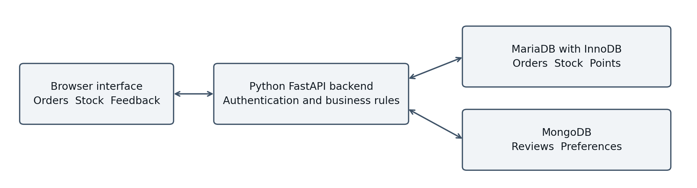
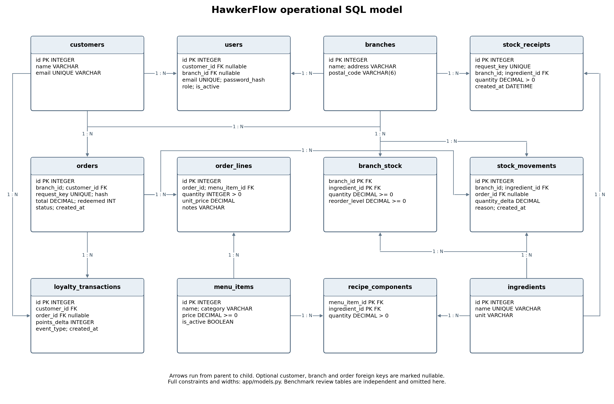

# HawkerFlow architecture and database design

HawkerFlow is an educational first integrated prototype for a fictional Singapore F&B chain. It connects ingredient stock, completed cash sales, loyalty points and purchase-linked feedback. MariaDB owns financial and operational facts; MongoDB owns reviews and optional preferences. The distinction follows transactional boundaries and query patterns, rather than a claim that either DBMS cannot store the other data type.

## Components



A plain HTML/CSS/JavaScript browser interface calls a Python FastAPI backend. SQLAlchemy uses MariaDB 10.11.14 with InnoDB; PyMongo uses MongoDB 7.0.16. These versions match the real engines used for integration and benchmark verification and the supplied Compose configuration. Browser requests never connect directly to a database. Configuration is supplied through environment variables. The live application must report unavailable stores rather than silently substitute test databases.

| Component | Responsibility | Authoritative data |
|---|---|---|
| Browser | Orders, inventory, customer feedback and manager dashboard | None |
| FastAPI | Authentication, authorization, validation and orchestration | None |
| MariaDB | Atomic checkout, restocking, sales analytics and points ledger | Orders, customers, menu, recipes, stock and point transactions |
| MongoDB | Reviews, manager replies, profile preferences and feedback aggregation | Review documents and optional profile attributes |
| Benchmark script | Same-input review-tag comparison | Separate reproducible fixtures; no live synchronization |

## Relational model

The operational schema contains fifteen tables, including the three batch tables added for extra credit. Two additional tables support a controlled review-analysis benchmark. Operational field declarations and constraints are authoritative in `app/models.py`; benchmark tables are constructed by `scripts/benchmark.py`. This dictionary explains their purposes.

| Table | Keys and important fields | Types and rules |
|---|---|---|
| `branches` | PK `id`; `name`, `address`, `postal_code` | Integer identifier; strings; postcode preserves leading zeroes |
| `customers` | PK `id`; unique `email`; `name` | Integer; VARCHAR names/email |
| `users` | PK `id`; unique `email`; optional FK customer/branch; `role` | Password hash; manager/cashier/customer role check; active flag |
| `menu_items` | PK `id`; `name`, `category`, `price`, `is_active` | DECIMAL(12,2) price >= 0; inactive records preserve history |
| `ingredients` | PK `id`; unique `name`; `unit` | String unit; all recipe/stock quantities use this unit |
| `recipe_components` | Composite PK/FKs `(menu_item_id, ingredient_id)` | DECIMAL(14,4) required quantity > 0 |
| `branch_stock` | Composite PK/FKs `(branch_id, ingredient_id)` | DECIMAL(14,4) stock and reorder threshold >= 0 |
| `orders` | PK `id`; branch/customer FKs; unique `request_key`; payload hash | Completed status; DECIMAL net total; redemption multiple of 100; UTC date |
| `order_lines` | PK `id`; order/item FKs; `quantity`, `unit_price`, `notes` | Positive integer quantity; DECIMAL price snapshot; bounded notes |
| `stock_movements` | PK `id`; branch/ingredient/order FKs | Signed nonzero DECIMAL change; reason; UTC date |
| `stock_receipts` | PK `id`; unique `request_key`; branch/ingredient FKs | Positive received quantity; UTC date; restock idempotency |
| `loyalty_transactions` | PK `id`; customer/order FKs; `points_delta`, `event_type` | Signed nonzero integer points; UTC date; ledger-derived balance |
| `stock_batches` | PK `id`; branch/ingredient FKs; optional unique receipt FK | Positive initial quantity; remaining between zero and initial; nullable expiry and cost; explicit source |
| `stock_batch_allocations` | PK `id`; batch/order FKs | Positive quantity; traces ingredients consumed by a sale |
| `stock_batch_discards` | PK `id`; unique batch and request key; manager and movement FKs | Positive disposed quantity; auditable idempotent expired-stock removal |
| `benchmark_reviews` | Benchmark PK `id`; `branch_id`, rating | Rating 1–5 fixture values; branch/rating index; independent fixtures |
| `benchmark_review_tags` | Benchmark composite PK `(review_id, tag)` | Review identifier; one normalized tag per fixture review; independent fixture table |

A branch has many orders and stock records. A customer has many orders and loyalty transactions. Each order has many order lines. Menu items and ingredients have a many-to-many relationship resolved by `recipe_components`; branches and ingredients are resolved by `branch_stock`. `order_lines` resolve orders and menu items while preserving duplicate items with different notes.



The image above shows the original foundation. The editable `erd.mmd` includes the three batch tables; the extra-credit guide explains their transaction flow and analytics.

Editable Mermaid source: `diagrams/erd.mmd`. The source schema may change during implementation; regenerate or update this diagram when field names or relationships change.

## Atomic checkout and idempotency

1. Authenticate staff and authorize the requested branch.
2. Validate the customer, active menu items, required recipes and quantities.
3. Check the unique request key. A retry with the same key and payload returns the committed result; reuse with a different payload is a conflict.
4. Lock the customer before calculating redemption; lock affected stock rows in a deterministic order to reduce deadlock risk.
5. Calculate total using server-side prices and snapshot those prices on order lines. A customer earns one point per whole dollar of the net sale; redemption uses multiples of 100 points for a $1 discount and cannot exceed the balance or sale value.
6. Reject shortages or invalid redemption. Commit order, lines, stock deductions, stock movement audit and point transactions together.
7. Roll back all changes on failure. MongoDB is absent from this commit path.

The SQL implementation and tests, rather than the diagram alone, must establish concurrency correctness. Unit tests using SQLite cannot prove MariaDB row-lock behaviour. Sixteen integration checks passed against real MariaDB/MongoDB engines, including concurrent checkout, retry and server constraint checks. Unit checks remain separately labelled; they do not establish DBMS row-lock semantics.

Restocking similarly binds its request key to branch, ingredient and quantity. A replay cannot add stock twice. Stock movement history explains each deduction or receipt. Loyalty balance is derived from its SQL ledger; MongoDB never maintains a competing balance.

## SQL reporting views

`v_low_stock` joins branches, ingredients and branch stock to show quantities below reorder thresholds. `v_completed_branch_revenue` aggregates completed order totals once per order; it avoids multiplying revenue through order-line joins. Both views are initialized with the schema and covered by automated checks. Branch/menu sales endpoints additionally use grouped join queries.

## MongoDB documents

`reviews` contains `order_id`, `customer_id`, `branch_id`, rating, review text, normalized tags, optional category ratings, bounded manager replies, moderation status and UTC timestamps. It has one unique review per order and branch/date indexes for the observed access patterns. Required IDs and dates, rating range, text lengths and array limits are validated. Replies may be embedded while their length is bounded; an unbounded conversation would require a separate collection or pagination model.

`customer_profiles` contains a unique SQL `customer_id`, optional dietary preferences, favourite categories, communication preferences and milestone metadata. Preferences may vary across customers without a wide table of nullable attributes. Preference milestones do not replace the SQL reward ledger.

Negative tag analysis explicitly counts tags in low-rated reviews for a branch and date range. Tags are normalized and deduplicated per review, so a complaint's count represents reviews mentioning it rather than repeated occurrences in one document. A separate pipeline computes monthly average ratings and review counts.

`external_review_examples` holds the downloaded UCI Yelp sentences separately: `source_record_id`, preserved `text`, binary `sentiment` (0 or 1) and `source="uci_yelp"`. The corpus contains 1,000 examples, 500 per class. It provides real feedback text for manager inspection, with unique source-record and sentiment indexes; it has no invented customer, order, branch, rating or date. Its deliberately balanced sentiment labels cannot establish a real restaurant complaint rate.

Example review shape (illustrative values; actual IDs are generated from completed orders):

```json
{
  "order_id": 1,
  "customer_id": 1,
  "branch_id": 1,
  "rating": 2,
  "text": "Synthetic teaching review: meal arrived cold.",
  "tags": ["cold food"],
  "category_ratings": {"food": 2, "service": 3},
  "replies": [],
  "moderation_status": "published",
  "created_at": "stored as BSON UTC date",
  "updated_at": "stored as BSON UTC date"
}
```

## Cross-database integrity and failure behaviour

The backend checks that a completed SQL order belongs to the authenticated customer before writing its review. It derives customer and branch IDs from that order, rather than trusting submitted identifiers. MongoDB has no foreign key into SQL. Orders and financial history are retained, so review identifiers remain meaningful; referential deletion needs an explicit policy if added later.

No distributed transaction is claimed. SQL checkout can succeed during a MongoDB outage; review/profile endpoints should return a clear availability error. Retrying a review is protected by the unique order index. A future outbox could coordinate asynchronous nonfinancial projections if needed, but it is outside the initial implementation.

## Access control and deployment

Managers manage menu and stock and access analytics. Cashiers operate their assigned branch. Customers read their own orders/points and manage their own reviews/preferences. Passwords are hashed and application queries are parameterized through the ORM. Development credentials belong in the user manual, and the deployment secret must be replaced outside a local demo. Production deployment additionally needs TLS, restricted DB credentials, backup procedures and abuse controls; those are not presumed established by the prototype.

## Evaluation and limitations

The benchmark uses the same review IDs, branch IDs, ratings and deduplicated tags in normalized SQL tables and MongoDB documents. It verifies identical answers before reporting warm repeated median and p95 latency, row/document count, indexes and environment. It does not prove a universal speed advantage. The completed experiment verified identical answers at 1,000, 10,000 and 50,000 reviews, with five warm-ups and thirty timed repetitions per size and indexed execution plans. The full measurements and environment metadata are preserved in the benchmark output; conclusions apply to this workload and environment.

The included NEA snapshot is historical; demonstration branches are fictional selections. Operational data are generated and do not represent actual spending or customer feedback. Completed cash sales, expiry batches, FEFO, demand estimates and RFM insights are implemented. Refunds, real payment processing, trained predictive models, horizontal scaling and production operation remain outside scope. See `EXTRA_CREDIT_GUIDE.md` for the new formulas and boundaries.

## Verification boundary

Verification passed 44 unit checks, sixteen real-engine integration checks and eight browser acceptance scenarios, with no JavaScript errors in the inspected desktop/mobile flows. The full deterministic seed loaded 200 orders, 100 purchase-linked reviews, fifty customer profiles and 1,000 UCI sentences; the rerun added no duplicates. Docker orchestration and a clean Windows installation have not been executed here. Teammates must reproduce the supplied setup before the final submission. These results establish an integrated assessed prototype, not production readiness.
